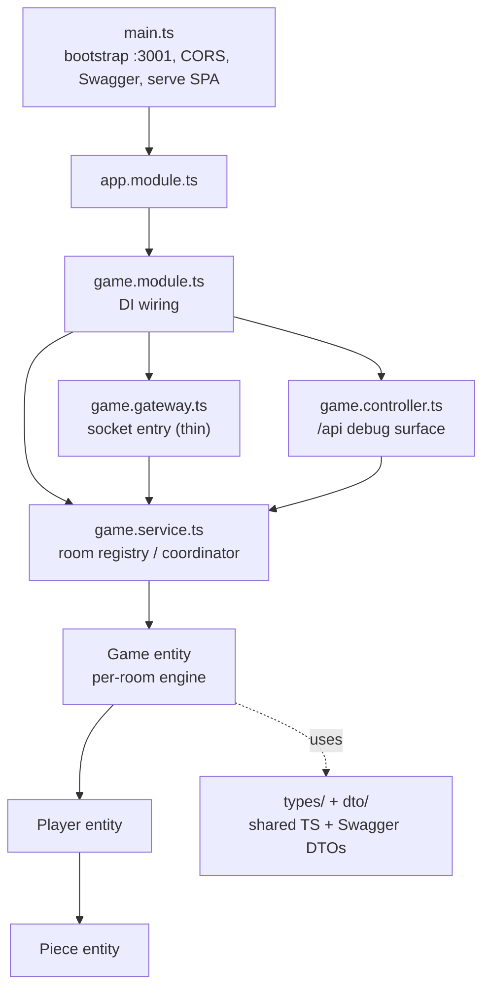
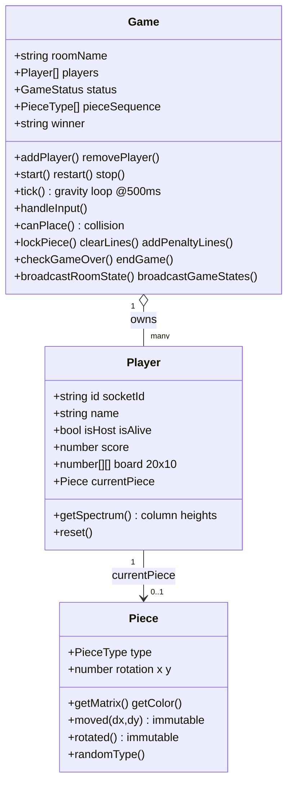
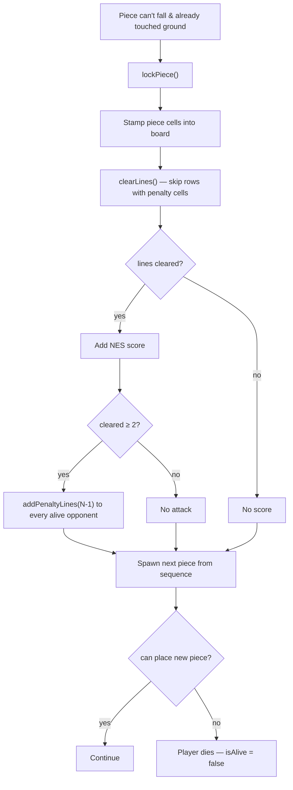
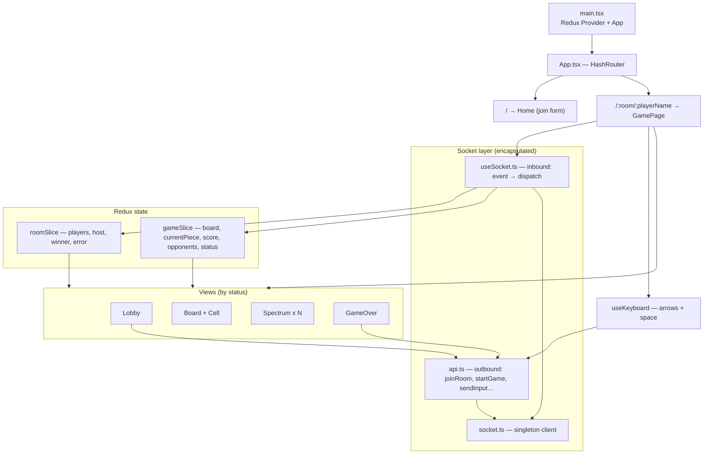
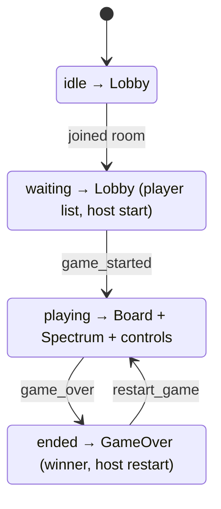
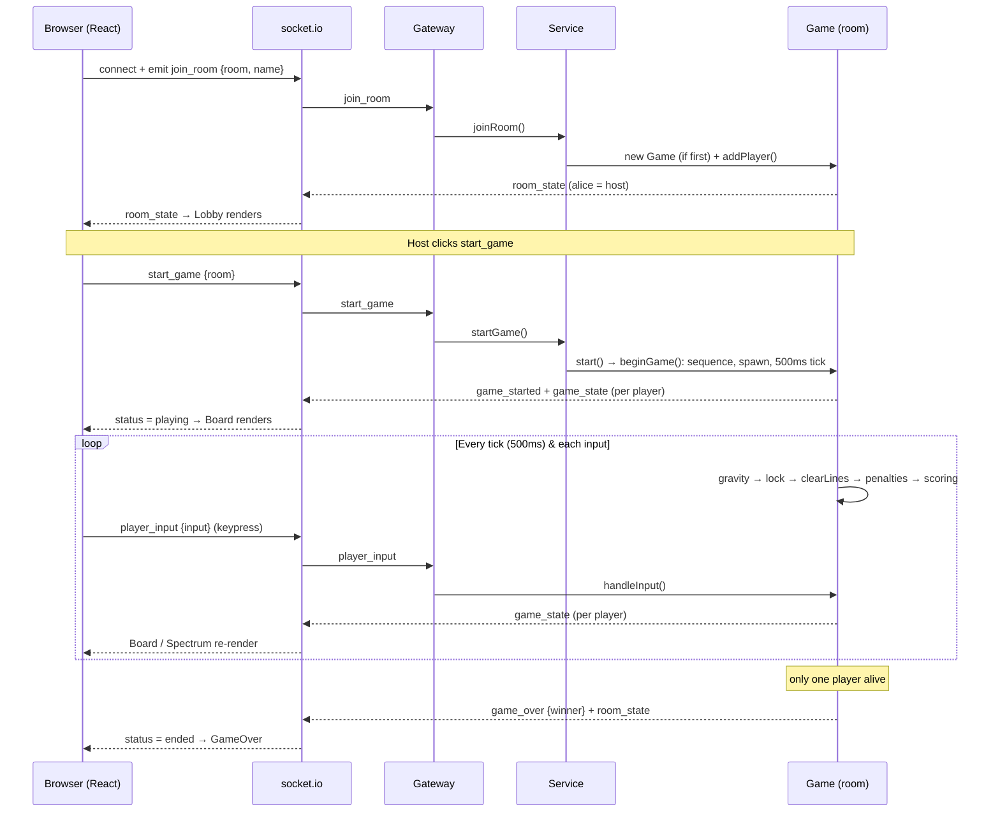

# Red Tetris — Architecture & How It Works

> A visual, top-to-bottom explanation of the whole project: from a single function
> up to full features, and what each piece works with.

**One-sentence summary:** It's a networked multiplayer Tetris. The **NestJS backend is
the single source of truth** (it runs *all* game physics), and the **React frontend is a
dumb renderer** that only sends keypresses and draws whatever the server pushes back.

> Mental model to hold onto:
> **Keys go up (client → server) as intent; state comes down (server → client) as truth.
> Redux mirrors that truth; components render it.**

---

## 1. High-level system

```mermaid
flowchart TB
    subgraph Browser["BROWSER — React SPA (purely functional, no game logic)"]
        URL["URL: /#/lobby-1/alice"]
        GP["GamePage<br/>picks view by status"]
        Store["Redux Store<br/>room + game slices"]
        Views["Views: Lobby / Board / Spectrum / GameOver"]
        KB["useKeyboard<br/>arrows + space"]
        Api["socket/api.ts<br/>outbound wrappers"]
        US["useSocket<br/>inbound listeners"]

        URL --> GP
        GP -->|setIdentity| Store
        Store -->|selectors| Views
        Views -->|start / restart| Api
        KB -->|sendInput| Api
        US -->|dispatch| Store
    end

    subgraph Net["socket.io (WebSocket, polling fallback)"]
        Chan[["join_room / start_game / restart_game / player_input<br/>↕<br/>room_state / game_state / game_started / game_over / host_changed / error_event"]]
    end

    subgraph Server["NestJS BACKEND — server-authoritative"]
        GW["GameGateway<br/>socket handlers (thin)"]
        Ctrl["GameController<br/>HTTP /api debug + Swagger"]
        Svc["GameService<br/>Map&lt;roomName, Game&gt; (in-memory, no DB)"]
        Game["Game (per room)<br/>tick loop, physics, scoring, win/lose"]
        Player["Player[]<br/>board, score, isAlive"]
        Piece["Piece<br/>shape, rotation, x/y"]

        GW --> Svc
        Ctrl --> Svc
        Svc --> Game
        Game --> Player
        Player --> Piece
    end

    Api -->|emit| Chan
    Chan -->|events| US
    Chan --> GW
    Game -->|io.to(room).emit| Chan
```

---

## 2. Tech stack — what it's built with

| Side | Tech |
| --- | --- |
| **Backend** | NestJS, socket.io, @nestjs/swagger, TypeScript, Express (serves built SPA), Jest (8 suites, ~89% coverage) |
| **Frontend** | React, Redux Toolkit, react-redux, react-router (HashRouter), socket.io-client, Vite, TypeScript, CSS Grid/Flexbox (no canvas/SVG/`<table>`) |
| **Transport** | socket.io over WebSocket (polling fallback) |
| **Persistence** | None — everything is an in-memory `Map` |

---

## 3. Backend — the brain (`backend/src`)

NestJS with an OOP core. Strict layering: the gateway/controller are thin; the real game
lives inside the entity classes.



### Layer responsibilities

| Layer | File | Job |
| --- | --- | --- |
| Bootstrap | `main.ts` | Starts server on `:3001`, socket.io adapter + CORS, Swagger at `/api/docs`, serves `frontend/dist` in prod with SPA fallback. |
| Modules | `app.module.ts` → `game.module.ts` | Nest dependency-injection wiring. |
| Gateway | `game.gateway.ts` | socket.io entry point. Receives events, calls the service. No logic. |
| Controller | `game.controller.ts` | HTTP debug surface (`/api/health`, `/api/games`, force start/restart/destroy). Not used by real gameplay. |
| Service | `game.service.ts` | Registry/coordinator: holds `Map<roomName, Game>`, creates rooms, routes calls, cleans up empties. |
| Entities | `entities/*.ts` | The OOP game engine — where the game actually lives. |
| Types & DTOs | `types/`, `dto/` | Shared interfaces + Swagger response classes. |

### The OOP core (class relationships)



---

## 4. Key game mechanics

- **Shared piece sequence** — `Game.pieceSequence` is one random list; every player pulls
  the same indices, so everyone gets identical pieces in the same order (fairness).
- **Board encoding** — `20 × 10` grid of numbers: `0` = empty, `1–7` = piece colors,
  `8` = indestructible penalty cell.
- **Tick loop (gravity)** — every 500ms each alive player's piece tries to fall one row.
- **Lock delay** — a piece locks one frame *after* it first touches the pile (grace frame).
- **Line clear** — full rows are removed, **except** rows containing a penalty cell (`8`).
- **Attack / penalties** — clearing `N ≥ 2` lines pushes `N − 1` indestructible rows onto
  every other alive opponent from the bottom.
- **Scoring** — classic NES line values `[0, 100, 300, 500, 800]` + soft-drop `1`/row +
  hard-drop `2`/row.
- **Spectrum** — each opponent's board is summarized to a 10-value column-height array
  (the little bar charts); you never see rivals' actual pieces.
- **Win/lose** — solo run ends only on top-out; multiplayer ends when ≤1 player is alive
  (last survivor wins).

### What happens when a piece locks



---

## 5. Frontend — the eyes & hands (`frontend/src`)

React + Redux Toolkit + Vite. Purely functional (no `this`, no classes). Never computes
physics; it renders server state and forwards keys.



### Frontend layers

| Layer | Files | Role |
| --- | --- | --- |
| Socket (encapsulated) | `socket/socket.ts`, `socket/api.ts`, `socket/useSocket.ts` | Singleton client; outbound wrappers; inbound hook wiring events → Redux. Components never touch the raw socket. |
| State (Redux) | `store/store.ts`, `roomSlice.ts`, `gameSlice.ts`, `hooks.ts` | `roomSlice` = lobby; `gameSlice` = live game. |
| Input | `hooks/useKeyboard.ts` | Maps `← → ↑ ↓ space` → `sendInput()`; only while playing; ignores typing in inputs. |
| Views | `pages/GamePage.tsx`, `components/*` | Choose + render UI based on `status`. |

### UI state machine (what GamePage shows)



---

## 6. End-to-end flow (one full round)



**On disconnect:** `handleDisconnect` → `Service.leaveRoom` → removes the player, promotes
the next host (`host_changed`), may end the game, and deletes the room if empty (memory cleanup).

---

## 7. Socket protocol (the contract)

### Client → Server

| Event | Payload |
| --- | --- |
| `join_room` | `{ roomName, playerName }` |
| `start_game` | `{ roomName }` |
| `restart_game` | `{ roomName }` |
| `player_input` | `{ roomName, input }` — `input ∈ left \| right \| rotate \| soft_drop \| hard_drop` |

### Server → Client

| Event | Payload |
| --- | --- |
| `room_state` | `{ roomName, status, players, hostId, winner }` |
| `game_state` | `{ status, isAlive, score, board, currentPiece, opponents }` |
| `game_started` | `{}` |
| `game_over` | `{ winner }` |
| `host_changed` | `{ newHostId, newHostName }` |
| `error_event` | `{ message }` |

---

## 8. Design principles enforced

- **Server-authoritative** — clients only send key events; never compute physics.
- **Backend is OOP** — `Piece`, `Player`, `Game` classes with prototype methods.
- **Frontend is purely functional** — zero `this` in `frontend/src`.
- **No canvas / SVG / `<table>`** — pure CSS Grid/Flexbox.
- **No database / no persistence** — in-memory `Map` only.
- **Single-server mode** — backend can also serve the built React app with client-side routing fallback.

---

## 9. File map (quick reference)

```
red-tetris/
├── backend/src/
│   ├── main.ts                     bootstrap, CORS, Swagger, SPA serving
│   ├── app.module.ts               root module
│   └── game/
│       ├── game.module.ts          DI wiring
│       ├── game.gateway.ts         socket.io handlers (thin)
│       ├── game.controller.ts      /api debug + Swagger
│       ├── game.service.ts         Map<room, Game> registry
│       ├── entities/
│       │   ├── game.entity.ts      per-room engine (tick, physics, scoring)
│       │   ├── player.entity.ts    board, spectrum, score, alive
│       │   └── piece.entity.ts     7 tetrominoes × 4 rotations (immutable)
│       ├── types/game.types.ts     shared TS types
│       └── dto/                    event + Swagger response DTOs
└── frontend/src/
    ├── main.tsx                    Redux Provider + App
    ├── App.tsx                     HashRouter (Home, GamePage)
    ├── pages/GamePage.tsx          status → view switch
    ├── socket/                     socket.ts, api.ts (out), useSocket.ts (in)
    ├── store/                      store.ts, roomSlice.ts, gameSlice.ts, hooks.ts
    ├── hooks/useKeyboard.ts        keys → sendInput
    ├── components/                 Board, Cell, Spectrum, Lobby, GameOver
    └── types/index.ts              shared TS types
```
